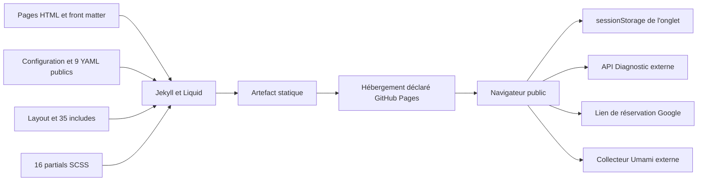
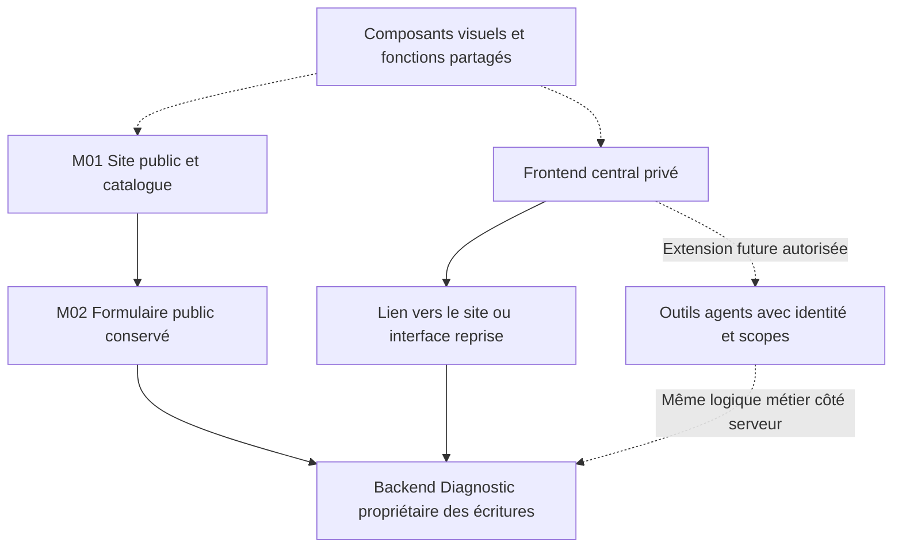

# 0. Résumé exécutif

Audit du **17 octobre 2026**, réalisé exclusivement par inspection statique du répertoire `/mnt/data/workspace/jboudoux-site`.

**OBSERVÉ — `jboudoux.fr` est le site professionnel public de Jimmy Boudoux**, une vitrine et un catalogue de prestations avec un formulaire de qualification « Diagnostic IA Entreprise ». C'est un site statique Jekyll/GitHub Pages, avec Liquid, Sass et JavaScript natif. Ce dépôt n'est ni une application de gestion de micro-entreprise, ni un portail IA opérationnel. Les prestations décrites dans les pages — agents, RAG, sandbox, FinOps, modernisation — ne constituent pas des fonctionnalités logicielles exécutées par le site.

**OBSERVÉ — Périmètre vérifié : 25 pages HTML, dont 22 indexables ; 22 fonctionnalités inventoriées ; 2 modules fonctionnels candidats.** Les 22 fonctionnalités comprennent 18 fonctions de consultation ou d'interaction publique, 3 capacités transverses d'administration/mesure/qualité et 1 fonctionnalité partielle ; leur décompte exact repose sur F01–F22 en section 2. Aucun endpoint backend n'est implémenté dans ce dépôt. Deux opérations HTTP externes sont référencées par le parcours Diagnostic : réception des réponses et challenge ALTCHA. Aucun Dockerfile ni manifeste Compose n'a été trouvé. Ces nombres décrivent les sources présentes, pas l'infrastructure réellement déployée.

**OBSERVÉ — Le backend du Diagnostic, son administration, ses données et ses secrets sont explicitement hors dépôt** (`README.md:123–127`). Son framework, ses schémas, ses contrôles d'accès, son stockage et ses effets de bord ne sont donc pas auditables ici. Les chemins `diagnostic-api` et `ops` sont exclus par configuration mais absents physiquement ; leur mention n'établit pas leur contenu.

**DÉDUIT — La valeur réutilisable est déjà bien séparée :** contenus et paramètres YAML, composants visuels Liquid/Sass, fonctions JavaScript de construction du payload et de transport, contrat public de soumission et tests. Une réécriture générale n'est pas justifiée par les éléments observés. La difficulté principale est de raccorder une future interface privée au backend externe sans présumer de ses capacités.

**RECOMMANDÉ — Conserver d'abord le site public et ses dépendances opérationnels**, ajouter un accès depuis la plateforme, puis copier les composants réellement utiles et, si nécessaire, reconstruire uniquement l'interface de collecte dans le frontend commun. Garder un seul backend responsable des écritures Diagnostic. La réutilisation des données éditoriales peut se faire sans migration ; celle des données privées du Diagnostic doit passer initialement par son propriétaire actuel et dépend d'un audit séparé.

| Priorité | Point de vigilance | Conséquence pour l'intégration |
|---|---|---|
| 1 | Backend et persistance du Diagnostic absents | Ne pas décider de les déplacer, de partager une base ou d'exposer une administration à des agents sans preuves supplémentaires. |
| 2 | Contrat JSON peu contraignant et acquittement client permissif | Spécifier validation, réponse de succès et idempotence avant d'ajouter un second client. Un timeout peut masquer une écriture déjà réalisée. |
| 3 | Frontière public/privé et stockage de brouillons | Isoler les données personnelles, les accès agents et l'origine web ; empêcher la publication du présent rapport lors d'un futur déploiement. |

Légende utilisée dans tout le rapport : **OBSERVÉ** = directement établi par une source locale ; **DÉDUIT** = conséquence argumentée de ces observations, non vérifiée en exécution ; **RECOMMANDÉ** = proposition future, non effectuée. Les références `chemin:ligne` visent les sources au moment de l'audit, sauf mention explicite de `_site`.

# 1. Identification et périmètre de l'application

| Élément | Constat et preuve |
|---|---|
| Nom réel | **OBSERVÉ :** `jboudoux.fr`, titre du README (`README.md:1`) et domaine déclaré dans `CNAME:1`. Le dossier est `jboudoux-site`. |
| Rôle | Présence professionnelle, présentation d'offres, acquisition et qualification de prospects ; aucune gestion de clients, projets, devis, factures ou agenda interne trouvée. |
| Utilisateurs | Visiteurs/prospects anonymes ; mainteneur disposant d'un accès aux sources et au déploiement. L'activité du consultant après réception des réponses est annoncée, pas implémentée ici. |
| Nature | Composant public d'un ensemble plus large comprenant au moins un backend Diagnostic externe et un service de mesure d'audience. |
| Hébergement déclaré | GitHub Pages (`README.md:129–139`, `mentions-legales/index.html:55–66`). Son état réel et la configuration du compte GitHub n'ont pas été consultés. |
| Cerveau / Beast | Aucun raccordement trouvé dans le code ou les configurations inspectés. Ne pas assimiler le lieu de travail local à la machine de production. |
| Périmètre inspecté | Sources des pages, Liquid, Sass, JavaScript, YAML publics, contrat JSON, manifests/verrous de dépendances, scripts, tests, workflow, documentation technique pertinente et structure des artefacts `_site`. |
| Exclusions de lecture | Aucun contenu de base, document métier privé, `notesprivate.md`, `privatespecs/`, fichier d'environnement, credential ou configuration locale assimilable à un secret consulté. Les répertoires privés ont été repérés uniquement comme chemins. |
| Limite de preuve | Pas de navigateur, requête HTTP, accès externe, commande Docker, test, build, installation, migration ou script applicatif exécuté. Aucune affirmation de disponibilité en production. |

| Répertoire / fichier | Responsabilité observée |
|---|---|
| `index.html`, dossiers d'offres et pages locales | Sources des pages et front matter ; 25 documents HTML de pages au total. |
| `_layouts/default.html` | Layout unique : métadonnées, analytics, header, contenu, footer et chargement des modules. |
| `_includes/` | 35 fragments HTML/Liquid, dont les sous-ensembles `head/` et `formation/`. |
| `_data/` | 9 fichiers YAML : diagnostic, engagement, FAQ, formations, interventions, navigation, tarifs, profil, services. |
| `_sass/`, `assets/css/site.scss` | 16 partials Sass et leur point d'entrée. |
| `assets/js/` | 7 modules ES : interactions globales et sous-ensemble Diagnostic. |
| `assets/vendor/altcha/` | Bundle tiers versionné et indication de version. |
| `contracts/` | Contrat public de l'enveloppe Diagnostic ; ce n'est pas un schéma de base. |
| `test/`, `script/`, `.github/` | Contrôles locaux et CI ; aucune logique serveur métier. |
| `_site/` | Artefact de génération existant, ignoré par Git ; ne constitue pas une seconde application ni une preuve de déploiement. |
| `_posts/` | Répertoire vide ; aucun blog implémenté à compter. |
| `docs/` | ADR et documentation d'audits/refactorisations ; exclusions de publication déclarées. |
| `node_modules/`, `.bundle/` | Matériel local de développement ; aucune installation effectuée, aucune valeur de configuration locale reproduite. |

# 2. Cartographie fonctionnelle

**OBSERVÉ — Convention de décompte :** une ligne Fxx représente une capacité cohérente, même si elle couvre plusieurs pages ou boutons. Il y a **22 fonctionnalités identifiées : 21 présentes et 1 partielle (F22)**. Les fonctions de qualité et de maintenance sont comptées explicitement ; elles ne sont pas des fonctions de gestion commerciale. Les fonctions annoncées mais dont l'implémentation est absente ne sont pas ajoutées à ce total.

Catégories : **C** consultation ; **M** modification locale ou envoi ; **A** administration via les sources ; **S** action sensible ; **T** fonctionnement technique automatique. Les complexités portent sur la reprise de la capacité visible, pas sur un backend externe inconnu.

| Fonctionnalité | Description | Frontend concerné | Backend concerné | Données utilisées | Dépendances | Complexité de migration |
|---|---|---|---|---|---|---|
| F01 — Présentation des interventions [C] | Accueil, méthode et trois piliers Concevoir/Construire/Transformer ; navigation vers les offres. | `/`, `/services/` ; `index.html:9`, `services/index.html:20` | Aucun ; génération Jekyll | `interventions.yml`, configuration | Includes de cartes et méthode | Faible |
| F02 — Catalogue d'expertises [C] | Consultation de huit pages d'offres, dont temps partagé, portails privés et sandbox ; textes et liens seulement. | Pages d'expertise listées ci-dessous ; `_data/services.yml:1–56` | Aucun | Catalogue, tarifs, textes des pages | Liquid, CTA contact | Faible à moyenne selon reprise du contenu |
| F03 — Catalogue de formations [C] | Liste et trois fiches, programmes, publics, modalités, objectifs, tarifs et adaptation/accessibilité. | `/formations/` et 3 fiches ; `_includes/formation-detail.html:1` | Aucun ; pas de LMS ni inscription interne | `formations.yml`, `engagement.yml` | Fragments `formation/` | Faible |
| F04 — Tarifs et périmètres [C] | Affichage de prix HT, fourchettes, périodes, options et minimum de catalogue ; aucun calcul de devis transactionnel. | `/tarifs/`, accueil, offres ; `_includes/price.html:1` | Aucun | `pricing.yml`, prix des formations | Formatage Liquid et valeurs dérivées | Faible |
| F05 — Zones d'intervention [C] | Pages Poitiers/Grand Ouest, zones, liens et offres contextualisées. | `/poitiers/`, `/grand-ouest/` | Aucun | `profile.yml`, services, FAQ | Cartes locales | Faible |
| F06 — Profil et liens professionnels [C] | Parcours, compétences, liens LinkedIn/Malt/Codeur ; pas d'authentification via ces plateformes. | `/about/`, footer, contact | Aucun | Configuration `socials` | Sites externes | Faible |
| F07 — Contact par email [C/S lors de l'envoi externe] | Ouvre le client mail ; objet prérempli pour un besoin d'accessibilité. Aucun email envoyé par ce code. | `/contact/`, fiches formation et liens `mailto:` ; `_includes/formation/support.html:18` | Aucun | Adresse de contact publique | Client mail de l'utilisateur | Faible |
| F08 — Rendez-vous externe [C/S hors site] | Les CTA ouvrent la page Google de réservation ; la réservation se déroule hors application. | Header, offres, pages locales, confirmation ; `_includes/booking-link.html:1–9` | Aucun backend local | `booking_url`, durée affichée | Google Calendar via lien | Faible ; conserver le lien |
| F09 — FAQ [C] | Déplier/replier des questions via `details/summary`, substitution de paramètres partagés. | Services, Poitiers, formations, sandbox ; `_includes/faq-list.html:1–13` | Aucun | `faqs.yml`, engagement, périmètre sandbox | HTML natif | Faible |
| F10 — Questionnaire Diagnostic [M] | Six étapes de questions et une étape de coordonnées ; progression, précédent/suivant, focus. | `/diagnostic-ia/`, `index.mjs:119–181` | Aucun pour la saisie | `diagnostic.yml`, état du formulaire | DOM, JavaScript | Moyenne |
| F11 — Règles de saisie Diagnostic [M] | Champs « autre », téléphone obligatoire selon préférence, outil « Aucun » exclusif ; contraintes natives et messages. | `diagnostic/index.mjs:85–135`, `core.mjs:75–94` | Validation serveur non visible | Réponses saisies, contraintes HTML | Définition YAML et coordonnées codées dans la page | Moyenne |
| F12 — Brouillon d'onglet [M/S] | Sauvegarde/restauration des réponses, identifiant et date de début ; suppression après succès ; reprise à l'étape 1. | `storage.mjs:3–26`, `index.mjs:38–77,215,242` | Aucun | `sessionStorage`, données personnelles | Origine web, onglet, clé versionnée | Moyenne : préserver l'origine ou prévenir la perte du brouillon |
| F13 — Soumission protégée [M/S] | Challenge ALTCHA, honeypot, enveloppe JSON, identifiant de soumission, POST, erreurs et possibilité de réessayer. | `altcha.mjs`, `transport.mjs`, `index.mjs:184–237` | Service Diagnostic externe | Réponses, contact, marketing, preuve ALTCHA | Réseau, CORS, compatibilité du backend | Moyenne pour le client ; serveur non déterminé |
| F14 — Confirmation [C] | Page statique de remerciement et CTA rendez-vous ; ne consulte ni reçu ni statut serveur. | `/diagnostic-ia/merci/` ; `index.mjs:213–216` | Aucun appel après envoi | Texte éditorial | Redirection navigateur | Faible ; renforcer la preuve de succès si nécessaire |
| F15 — Mesure d'audience [T] | Script Umami, événements début/étapes/fin Diagnostic et clics de réservation autorisés. | `_includes/head/analytics.html:1`, `site-core.mjs:35–47`, `core.mjs:169–174` | Collecteur externe | Noms techniques, emplacement, UTM source/campagne | `collect.jboudoux.fr`, `window.umami` | Faible à moyenne ; revoir la minimisation |
| F16 — Navigation et interactions globales [C/T] | Menu responsive, fermeture par Échap/clic extérieur/lien, état actif ; année courante du footer. | Header/footer, `site-core.mjs:1–33` | Aucun | Navigation, feature flag, année | CSS responsive, JS ; contenu consultable par liens | Faible |
| F17 — Référencement [T] | Titres, descriptions, canonical, Open Graph/Twitter, JSON-LD identité/services/formations/FAQ, sitemap et robots. | `_includes/head/`, `sitemap.xml:12–35`, `robots.txt` | Génération statique seulement | Front matter, URL, catalogues | Jekyll/Liquid | Moyenne si changement d'URLs |
| F18 — Informations légales [C] | Mentions et confidentialité ; décrit les usages des données et les droits. Pas de workflow d'exercice des droits implémenté. | `/mentions-legales/`, `/politique-confidentialite/` | Aucun | Textes publics et profil | Email comme point de contact | Faible ; vérifier l'adéquation au futur traitement |
| F19 — Page d'erreur [C] | Retour accueil et services depuis la page 404. | `/404.html` | Hébergeur pour le routage effectif | Texte statique | Configuration de l'hébergement | Faible |
| F20 — Maintenance éditoriale [A/S] | Modifier sources/YAML/configuration puis publier via Git ; pas d'interface d'administration. | Pas d'écran d'édition ; `README.md:40–119` | Chaîne de génération, pas d'API CRUD | Fichiers versionnés | Droits Git/GitHub Pages | Faible si source de vérité unique |
| F21 — Contrôle qualité automatisé [T/A] | Workflow push/PR et contrôles de rendu/contrat/accessibilité/liens/configuration/JS/format. | Aucun écran métier ; `.github/workflows/validate-sitemap.yml:3–23` | Runner GitHub Actions | Sources, fixtures de test | Ruby, Node, dépendances | Faible ; contrôles à adapter à la cible |
| F22 — Portfolio préparé [C, PARTIEL] | Page « en préparation », masquée des menus et de l'accueil ; aucun cas publié. | `/realisations/`, `index.html:46–57`, `_config.yml:8` | Aucun | Placeholder et `portfolio_enabled: false` | Activation éditoriale future | Faible ; ne pas inventer de références |

## Inventaire exhaustif des pages et routes frontend

**OBSERVÉ :** navigation multipage par URLs de fichiers générés, sans routeur SPA. Les 24 sources `index.html` et `404.html` donnent les 25 routes suivantes. Le statut indexable est établi par le front matter, cohérent avec les 22 chemins attendus de `test/site_test.rb:6–43` ; aucun résultat de test n'est revendiqué.

| Route | Source | Écran / actions principales | Indexable |
|---|---|---|---|
| `/` | `index.html:1` | Présentation, ancres, offres, tarifs, réservation | Oui |
| `/services/` | `services/index.html:1` | Piliers, expertises, FAQ, liens contact/tarifs/formation | Oui |
| `/ai-adoption/` | `ai-adoption/index.html:1` | Adoption, lien Diagnostic, réservation | Oui |
| `/ai-engineering/` | `ai-engineering/index.html:1` | Offres ingénierie, liens portails/sandbox/tarifs, réservation | Oui |
| `/ai-finops/` | `ai-finops/index.html:1` | Offre coûts IA, liens audit/prototype/formation, réservation | Oui |
| `/data-reporting/` | `data-reporting/index.html:1` | Offre Data, réservation | Oui |
| `/software-rescue/` | `software-rescue/index.html:1` | Offre de reprise logicielle, réservation | Oui |
| `/fractional-lead/` | `fractional-lead/index.html:1` | Accompagnement récurrent et prix, réservation | Oui |
| `/ia-privee-locale/` | `ia-privee-locale/index.html:1` | Présentation d'architectures/offres, ancres, liens, réservation | Oui |
| `/sandbox-ia-locale/` | `sandbox-ia-locale/index.html:1` | Présentation du POC et options, FAQ, réservation | Oui |
| `/formations/` | `formations/index.html:1` | Catalogue, FAQ, liens programmes et contact | Oui |
| `/formations/ai-literacy/` | `formations/ai-literacy/index.html:1` | Programme, modalités, prix, réservation/email | Oui |
| `/formations/finops-ia/` | `formations/finops-ia/index.html:1` | Programme, modalités, prix, réservation/email | Oui |
| `/formations/ia-locale/` | `formations/ia-locale/index.html:1` | Programme, modalités, prix, liens ingénierie, réservation/email | Oui |
| `/poitiers/` | `poitiers/index.html:1` | Présentation locale, cartes, FAQ, réservation | Oui |
| `/grand-ouest/` | `grand-ouest/index.html:1` | Zones et interventions, liens offres, réservation | Oui |
| `/about/` | `about/index.html:1` | Profil, liens formation/accompagnement/LinkedIn, réservation | Oui |
| `/contact/` | `contact/index.html:1` | Réservation et mailto ; aucun formulaire de contact | Oui |
| `/tarifs/` | `tarifs/index.html:1` | Navigation par ancres, prix/périmètres, liens offres, réservation | Oui |
| `/diagnostic-ia/` | `diagnostic-ia/index.html:1` | Questionnaire unique, envoi, lien confidentialité/réservation | Oui |
| `/diagnostic-ia/merci/` | `diagnostic-ia/merci/index.html:1` | Remerciement statique, réservation | Non : `noindex` + `sitemap: false` |
| `/mentions-legales/` | `mentions-legales/index.html:1` | Informations, lien hébergeur et contact | Oui |
| `/politique-confidentialite/` | `politique-confidentialite/index.html:1` | Information et mailto pour les droits | Oui |
| `/realisations/` | `realisations/index.html:1` | Placeholder, liens services/contact ; accessible directement | Non : `noindex` + `sitemap: false` |
| `/404.html` | `404.html:1` | Liens accueil/services | Non : `noindex` + `sitemap: false` |

**Menus observés :** header et footer reprennent `_data/navigation.yml:1–11` : Services, Réalisations conditionnel, À propos, Tarifs, Contact. Réalisations est désactivé ; le header ajoute le CTA de réservation. Les pages de service/formation marquent Services comme actif (`_includes/header.html:19–30`). Le footer ajoute les expertises, formations, temps partagé, Diagnostic, zones et pages légales (`_includes/footer.html:30–62`). Les sous-sections utilisent des ancres, pas des routes supplémentaires.

**Boutons et formulaires observés :** un seul formulaire métier (`diagnostic-ia/index.html:125`). « Commencer » cible l'ancre du questionnaire et marque le début ; « Suivant » valide l'étape et avance ; « Précédent » recule ; « Envoyer » lance ALTCHA puis le POST. Le bouton du menu ouvre/ferme la navigation. Les autres CTA sont des liens internes, des ancres, des liens externes ou des `mailto:`. Les FAQ utilisent des contrôles HTML natifs.

**Processus automatiques :** génération des pages/SEO lors du build, CI au push/PR, vérification mensuelle des dépendances npm/Bundler par Dependabot (`.github/dependabot.yml:1–13`), sauvegarde du brouillon à la saisie, événements de mesure, calcul ALTCHA ponctuel côté navigateur et année courante. Aucun cron, daemon métier, file de tâches, polling ou service worker trouvé. L'analyse humaine et le retour du diagnostic sont annoncés par la page (`diagnostic-ia/index.html:65–104`) ; aucune production de score, email, PDF ou rapport n'est implémentée ici.

**Parties inutilisées identifiables :** `_includes/expertise-grid.html` et `_includes/local-intervention.html` n'ont aucun appel Liquid littéral atteignable depuis les pages/layouts inspectés. Le premier conserve des traitements de champs `keywords`, `optional`, `home_link_label` et `link_label` ; cela ne prouve pas une fonctionnalité active. `service.number` n'est pas référencé dans les templates inspectés. Les scripts classiques `extra_js` sont pris en charge par le layout, mais aucune page actuelle n'en déclare ; le Diagnostic utilise `extra_modules`. Le flag portfolio ne protège pas l'accès direct.

# 3. Architecture frontend actuelle

## Stack et dépendances réellement concernées

| Couche | Version déclarée/verrouillée | Usage et limites de preuve |
|---|---|---|
| Jekyll | 3.10.0, via `github-pages` 232 | Génération statique ; `Gemfile.lock:53–95,111–124`. Pas de Ruby en exécution navigateur. |
| Liquid | 4.0.4 | Includes, boucles, conditions, transformations ; `Gemfile.lock:226`. |
| Sass | 3.7.4 ; convertisseur Jekyll 1.5.2 | Compilation SCSS par Jekyll ; `Gemfile.lock:166–167,259`. |
| Kramdown | 2.4.0 | Moteur Markdown configuré ; pages actuelles majoritairement HTML ; `_config.yml:33`. |
| JavaScript | Modules ES natifs, sans transpilation/bundler | 7 modules applicatifs ; aucun React/Vue/Angular dans le code de l'application. |
| ALTCHA | 3.2.2 | Web Component anti-robot auto-hébergé, chargé sur la page Diagnostic ; `assets/vendor/altcha/VERSION:1`. |
| CSS/UI | SCSS propre, variables CSS et HTML natif | Pas de bibliothèque de composants UI ni de police web distante déclarée. `Inter` est un nom de préférence dans une pile système, pas une intégration de chargement de police. |
| Formatage de développement | Prettier 3.9.6 ; plugin Liquid 1.11.0 | Dépendances `devDependencies`, pas des composants runtime ; `package.json:8–11`. |

**OBSERVÉ :** le bundle tiers ALTCHA contient son propre runtime compilé, notamment des références Svelte et des Web Workers. Cela n'en fait pas une application frontend Svelte ; aucune version Svelte indépendante n'est déclarée ici. L'empreinte du bundle correspond à celle documentée dans `docs/altcha-maintenance.md:7`, vérification effectuée par calcul de hachage en lecture seule.

## Organisation, état et couplages

Le layout unique (`_layouts/default.html:1–22`) compose tous les écrans. Les variantes de thème sont issues du catalogue ou du front matter (`_includes/page-theme.html`). Les contenus partagés résident dans YAML ; le contenu spécifique reste dans chaque page. Cette séparation est documentée et visible, sans couche applicative supplémentaire.

Le Diagnostic est déjà découpé : `core.mjs` pour les transformations, `storage.mjs` pour les brouillons, `altcha.mjs` pour la protection, `transport.mjs` pour HTTP et `index.mjs` pour le DOM. L'état reste local à une IIFE : `state`, `currentStep`, `started`, `sending` (`index.mjs:16–41`). Pas de store global ni de gestionnaire d'état tiers. Le brouillon conserve les valeurs mais pas l'étape courante.

Les règles métier côté frontend concernent la représentation de l'offre, les minima/prix HT, le choix exclusif « Aucun », les champs conditionnels, la préférence téléphonique, le type `general_ai`, la construction des groupes JSON et la durée annoncée. Aucun scoring IA ou calcul financier de devis/facture. Certaines règles sont réparties entre `_data/diagnostic.yml`, la page et le JavaScript ; elles devront être documentées comme un contrat commun plutôt que recopiées dans un nouveau client.

| Couplage | Source | Implication |
|---|---|---|
| Payload Diagnostic | `core.mjs:96–146` | Noms, imbrication, booléens, identifiant et date doivent rester compatibles avec le backend externe. |
| Endpoint et challenge | `_config.yml:28`, `diagnostic-ia/index.html:128,147` | `/challenge` est concaténé à l'URL de soumission ; reprendre les règles d'URL et CORS. |
| Erreurs serveur | `transport.mjs:47–54`, `index.mjs:218–229` | Le client attend `message` et `fields` ; les clés de champs doivent correspondre aux noms des inputs. |
| Stockage | `core.mjs:1,18–33`, `storage.mjs` | Format de brouillon non validé strictement ; clé et origine conditionnent sa reprise. |
| Affichage partagé | `price.html`, `formation-starting-price.html`, `page-structured-data.html:19–35` | Garder cohérents l'écran, les minimums et les données structurées. |
| Styles globaux | `_foundation.scss:50–65,94–115`, `_diagnostic-form.scss:5–7` | Resets et styles de balises globaux ; risque de collisions si import complet dans une plateforme existante. |

## Chargements, erreurs, accessibilité et réutilisation

**OBSERVÉ :** aucune attente réseau pour le contenu éditorial statique. Lors de l'envoi : bouton désactivé, textes de progression et `aria-busy` ; erreurs par champ, `aria-invalid`, alerte générale et repositionnement sur l'étape fautive. Timeout de soumission déclaré à 20 secondes et timeout de résolution ALTCHA à 20 secondes. Aucun retry automatique ni toast global. L'attribut `retryable` produit par le transport n'est pas utilisé par l'interface.

Le code prévoit un lien d'évitement, des landmarks, des focus visibles, des annonces de progression/erreurs, le clavier pour le menu et des règles de mouvement réduit. Cela constitue une base réutilisable ; l'accessibilité réelle du parcours n'a pas été testée pendant cet audit. La présentation contient un message `noscript`, mais aucun mode d'envoi sans JavaScript.

**RECOMMANDÉ :** extraire d'abord les tokens de couleur/espacement/rayons, boutons, cartes, champs, FAQ et progression. Conserver les contenus YAML, le contrat et les fonctions pures. Les templates Liquid restent réutilisables tels quels dans une zone statique ; les convertir en composants du futur framework uniquement pour les écrans effectivement reconstruits. Ne pas importer la feuille globale entière dans une interface privée sans isoler sa portée.

**Évaluation :** remplacement du site complet **moyen**, car il comprend 25 URLs et du SEO ; remplacement du seul formulaire **moyen**, principalement pour les invariants d'intégration ; simple lien depuis la plateforme **faible**. Aucun motif observé imposant de remplacer Jekyll ou de reconstruire toutes les pages pour atteindre l'objectif d'interface privée unifiée.

# 4. Architecture backend actuelle

**OBSERVÉ — Aucun backend métier local.** Il n'y a ni serveur HTTP applicatif, contrôleur, service de domaine, ORM, repository, worker ou couche d'accès aux données. Jekyll et les scripts Ruby sont des outils de génération/validation. Les dépendances Ruby du méta-package `github-pages` ne constituent pas un backend de gestion. Les scripts `validate_*.rb` exécutent les tests correspondants (`script/validate_diagnostic.rb:4–5`, `script/validate_sitemap.rb:4–5`).

Le composant critique observable est le client du backend externe : sérialisation, anti-robot, POST et gestion du résultat. L'appel est asynchrone dans le navigateur ; il ne prouve pas l'existence d'une tâche asynchrone serveur. La page promet une analyse humaine et un retour, mais aucun état métier `reçu/en cours/validé/envoyé` n'est exposé ici.

| Option demandée | Applicabilité | Avantage | Coût / risque / prérequis |
|---|---|---|---|
| 1. Réutiliser le backend sans modification | **Conditionnelle** au backend externe | Conserve la propriété des données et les traitements existants | Vérifier contrat, origine autorisée, authentification, idempotence et capacité multi-client. Ce dépôt ne permet pas d'attester l'absence de modification nécessaire. |
| 2. Déplacer le code backend dans le nouveau projet | **Non évaluable ici** | Pourrait simplifier la maintenance si responsabilités proches | Code absent ; coûts, dépendances, stockage et procédures de démarrage inconnus. Aucune décision de déplacement justifiée. |
| 3. Déplacer et refactoriser progressivement | **Conditionnelle après audit séparé** | Permettrait une reprise ciblée avec tests | Requiert copie initiale, fixtures, connaissance des écritures et démarrages ; ne pas coupler ce chantier à la refonte du site. |
| 4. Extraire des fonctions communes | **Pertinente pour le client et le contrat**, pas pour un backend absent | Réutiliser transformations/validation et tests | Stabiliser les entrées/sorties et rendre les règles explicites ; pas de package séparé nécessaire avant un second consommateur réel. |
| 5. Garder un service autonome et communiquer par API | **Option de départ la mieux étayée** | Architecture déjà observée, pas de partage de base ni de double écriture | Maintenir l'accès du site public, cadrer l'accès privé/agents et les contrats ; ne préjuge pas de la frontière définitive. |
| 6. Réécrire les seuls composants problématiques | **Pertinente côté adaptateur frontend** | Corriger acquittement, timeout et validation du contrat sans tout reprendre | Tests ciblés sur les scénarios d'erreur ; toute correction serveur reste hors périmètre et doit être coordonnée. |

**Robustesse du client à traiter avant une seconde interface :** succès accepté pour tout statut HTTP 2xx même avec JSON illisible (`transport.mjs:47–49`) ; identifiant de soumission présent mais aucune preuve d'idempotence serveur ; attente d'enregistrement du Web Component hors timeout (`altcha.mjs:14–40`) ; format de brouillon fusionné sans contrôle de type fin (`core.mjs:27–33`). Ces limites ne prouvent pas une défaillance du backend.

# 5. Inventaire des API et capacités pour agents IA

## Opérations HTTP observables

**OBSERVÉ : 0 endpoint backend implémenté dans ce dépôt ; 2 opérations externes configurées.** L'existence d'une référence cliente ne prouve ni disponibilité ni exhaustivité de l'API externe. Son nombre total d'endpoints est **Non déterminé**. Aucun appel n'a été effectué.

| Méthode HTTP | Route | Fonction | Authentification | Lecture/Écriture | Effets de bord | Fichier source |
|---|---|---|---|---|---|---|
| POST | `https://diagnostic-ia-api.jboudoux.fr/v1/diagnostics` | Transmettre le Diagnostic complet | Pas de jeton d'identité ni d'en-tête Authorization dans le client ; preuve ALTCHA dans le JSON, honeypot et métadonnées. Contrôles serveur inconnus. | Soumission de données ; écriture serveur attendue, non vérifiée | Réception/persistance/notifications exactes inconnues ; côté client, suppression du brouillon et redirection après 2xx | `_config.yml:28`, `core.mjs:96–146`, `transport.mjs:30–54`, `index.mjs:195–216` |
| GET | `https://diagnostic-ia-api.jboudoux.fr/v1/diagnostics/challenge` | Obtenir le challenge anti-robot | Aucun jeton explicite configuré ; comportement serveur inconnu | Lecture technique côté client ; éventuelle allocation serveur inconnue | Calcul local de preuve ; journalisation/quota serveur inconnus | `diagnostic-ia/index.html:147`, `altcha.mjs:14–49`, bundle `assets/vendor/altcha/altcha.min.js:1` : fetch du challenge, GET par défaut |

Le POST utilise `Content-Type: application/json`, sans `credentials: include` ni authentification applicative explicite (`transport.mjs:32–36`). Le navigateur peut émettre un prévol CORS en fonction de l'origine ; cela relève du protocole, pas d'un troisième endpoint métier vérifié. ALTCHA est une protection anti-robot, **pas une autorisation de consulter des données privées**. Le widget peut interpréter une configuration fournie par le serveur ; aucune capacité supplémentaire n'est déduite d'options génériques présentes dans le bundle tiers.

Autres ressources : pages HTML, `sitemap.xml`, `robots.txt`, assets et `contracts/diagnostic-submission.schema.json` sont des ressources statiques, pas des API métier. Le script analytics est chargé par GET via une balise ; les routes d'ingestion réellement utilisées par le script distant sont introuvables ici. Le lien Google et les profils professionnels n'impliquent pas d'intégration API.

**Fonctions accessibles seulement par API :** aucune fonction métier supplémentaire identifiée dans ce dépôt. Le challenge est une opération technique utilisée par le formulaire, sans écran propre. Les capacités éventuellement réservées à l'API du backend externe sont **Non déterminé**.

## Contrat et lacunes

**OBSERVÉ :** `contracts/diagnostic-submission.schema.json:1–21` déclare JSON Schema 2020-12, le type constant `general_ai`, les groupes obligatoires et quelques clés obligatoires de `contact`. Il ne décrit pas les types des sous-champs, les enums du questionnaire, les longueurs, les formats, l'exclusion de propriétés supplémentaires ou les contraintes conditionnelles. Aucun validateur de ce schéma n'est appelé en runtime. Le test `test/js/diagnostic.test.mjs:209–215` vérifie l'enveloppe, pas la validation complète d'une requête.

**Introuvable :** document OpenAPI, contrat de réponse typé, codes d'erreurs documentés, identifiant de reçu, garantie d'unicité, durée de validité/rejeu du challenge, CRUD des diagnostics, endpoint de statut ou administration. Aucun MCP déclaré. Les fonctions annoncées d'archivage/suppression dans la politique de confidentialité ne permettent pas d'inférer leurs routes ni leur implémentation (`politique-confidentialite/index.html:58–64`).

**RECOMMANDÉ :** maintenir OpenAPI à partir du backend réel, en réutilisant un schéma JSON enrichi et partagé. Définir requêtes, réponses, erreurs par champ, limites, protections anti-abus et sémantique de `submission_id`. Sans accès au backend, un document client provisoire doit marquer ces éléments comme à confirmer ; ne pas générer une spécification présentant des routes supposées comme opérationnelles.

## Parité humain / agent et accès central

| Capacité | Existant | Candidat outil IA / interface centrale | Autorisation recommandée |
|---|---|---|---|
| Consulter offres, prix et programmes publics | Oui, fichiers et pages statiques | Lecture d'un catalogue dérivé des mêmes YAML ; outil seulement si les agents en ont besoin | Lecture limitée aux sources publiques, sans accès au système de fichiers complet |
| Préparer/valider une soumission | Transformation du payload existante ; validation partielle côté UI | Fonction pure commune ou adaptateur appelant la même validation métier serveur | Autorisation par utilisateur et finalité ; validation serveur toujours requise |
| Envoyer un Diagnostic | POST externe prévu pour le navigateur | Candidat après définition d'une authentification machine et des contrôles de périmètre | **Confirmation humaine explicite avant transmission** de réponses/coordonnées ; identité et journal d'action |
| Consulter/modifier un diagnostic reçu | Aucune API visible | À inventorier dans le backend privé ; ne pas l'exposer par défaut | Accès par propriétaire/objet, scopes distincts lecture/écriture, minimisation des champs |
| Analyser, valider un score ou envoyer le retour | Analyse humaine annoncée ; aucun traitement local | Aide à la rédaction envisageable seulement après audit du backend | Validation humaine avant résultat engageant ou communication au prospect |
| Réserver un rendez-vous / envoyer un email | Liens uniquement | Conserver les liens ; aucun outil d'écriture Calendar/mail existant ici | Confirmation si un futur outil crée/modifie un événement ou envoie un message |
| Modifier prix/contenu/publier | Édition Git, pas d'API | Proposition de modification revue, pas shell général ni publication automatique | Accès restreint ; validation éditoriale avant mise en ligne |

Une UI privée peut initialement ouvrir le site existant. Pour un formulaire intégré, appeler le même backend si CORS et droits le permettent ; ajouter un relais serveur uniquement si un besoin réel de secret, d'autorisation ou de politique réseau le justifie. Un simple relais ne doit pas dupliquer les règles métier. Pour les agents, prévoir une identité propre, des scopes révocables, un contrôle des objets et un audit ; le challenge public ne remplace pas ces mécanismes et ne doit pas être simplement contourné.

**Tâches longues :** aucun protocole de suivi trouvé. Le frontend soumet puis affiche un remerciement ; la promesse d'un retour humain n'est pas un statut suivi. Si la plateforme pilote ensuite une analyse différée, définir dans le backend propriétaire un identifiant et des états consultables, les résultats autorisés et la reprise sur erreur. Aucun besoin observé d'ajouter dès maintenant une queue ou un service de tâches distinct.

# 6. Modèles de données et persistance

## Inventaire sans consultation de contenus privés

| Stockage / modèle | Structure déclarée ou usage | Écritures observables | Références |
|---|---|---|---|
| Configuration Jekyll | Identité, URLs publiques, liens sociaux, analytics, feature flag, options de génération | Édition manuelle des sources ; pas de modification au runtime | `_config.yml:1–57` |
| Catalogue d'interventions | Liste avec identifiant, verbe, thème, périmètre, livrables, liens et CTA | Maintenance via Git | `_data/interventions.yml`, `services/index.html:20–59` |
| Catalogue de services | 8 entrées : slug, titre, description courte, thème et attributs de présentation | Maintenance via Git | `_data/services.yml:1–56` |
| Tarifs | Objets imbriqués, montants entiers EUR HT, bornes/options/périodes/durées | Maintenance via Git ; affichage uniquement | `_data/pricing.yml:1–91`, `_includes/price.html:1–5` |
| Formations | 3 clés ; objectifs, programme, formats, publics, modalités et `prices[]` | Maintenance via Git | `_data/formations.yml:1–129` |
| FAQ / navigation / profil / engagement | Groupes de questions, menus, structure d'adresse/zones publiques, durées et emplacements analytics | Maintenance via Git | 4 autres YAML dans `_data/` |
| Questionnaire | 6 étapes YAML, 20 questions nommées ; types, options, contraintes, deux champs « autre ». La 7e étape contact est en HTML. | Maintenance via Git, pas réponses persistées dans YAML | `_data/diagnostic.yml:1–235`, `diagnostic-ia/index.html:257–365` |
| Brouillon navigateur | `{ values, submission_id, form_started_at }`, clé `jboudoux_diagnostic_general_ai_v1` | `sessionStorage.setItem` sur saisie/changement ; `removeItem` après succès | `core.mjs:1,18–33`, `storage.mjs:3–26`, `index.mjs:161–171,215` |
| Soumission JSON | Groupes `company`, `ai_usage`, `governance`, `costs`, `automation`, `needs`, `contact`, `marketing`, puis `altcha` | Envoi HTTP ; stockage serveur non visible | `core.mjs:96–146`, `index.mjs:200–210` |
| Artefacts générés | HTML, CSS compilé, ressources copiées dans `_site/` | Produits par build, pas exécuté pendant l'audit | `.gitignore:1–5`, `script/check:8–13` |
| Bases/documents privés Diagnostic | Modèles, tables, fichiers et emplacements introuvables | Non déterminé | Absence du backend, `README.md:125` |

**OBSERVÉ :** aucune base SQLite, PostgreSQL ou autre base déclarée par le code applicatif ; aucun ORM, DDL ou script de migration trouvé dans les sources inspectées. Aucun volume Docker ou bind mount déclaré. Aucun upload, pièce jointe, gestion documentaire, stockage objet ou téléchargement privé implémenté. Les images de `assets/img/` sont des ressources publiques de communication. Les livrables/supports décrits dans les offres ne prouvent pas un stockage documentaire applicatif.

Le payload comprend les réponses d'entreprise, usages/outils, gouvernance, coûts, architecture, besoins/priorités et coordonnées professionnelles. Le marketing inclut cinq UTM, `partner`, référent et page d'arrivée ; valeurs limitées à 200 caractères pour les paramètres et 1 000 pour le contexte (`core.mjs:36–49`). Aucune réponse réelle ni coordonnée de prospect n'a été consultée.

## Réutilisation sans migration et risques de coexistence

| Risque | Évaluation spécifique | Mesure recommandée sans transformation des données existantes |
|---|---|---|
| Chemins cassés | Les pages utilisent largement `relative_url`/`absolute_url`, mais modules et includes ont des chemins relatifs ; `robots.txt:4` et l'origine des tests sont fixes | Copier en gardant l'arborescence ; vérifier `baseurl`, canonical, images, imports, succès et lien API ; adapter uniquement une copie/configuration de préproduction |
| Identité système / permissions | Aucune dépendance UID/GID métier déclarée ; droits du stockage externe inconnus | Ne pas monter les données du backend dans la nouvelle application ; si reprise ultérieure, inventorier propriétaire, mode, utilisateur de service et chemins avant démarrage |
| Double écriture | Deux UIs peuvent soumettre au même backend ; le client garde un identifiant mais déduplication non prouvée | Un seul propriétaire serveur des écritures ; pas de synchronisation entre bases ni de double POST de comparaison ; confirmer l'idempotence serveur |
| Concurrence | Pas de base partagée locale ; risque de modifications éditoriales divergentes entre copies | Une seule source de vérité pour YAML/configuration ; les autres copies servent de référence ou de snapshots en lecture seule |
| Schéma incompatible | Le schéma JSON public est incomplet ; modèle serveur et versionnement inconnus | Geler le payload v1 pour le premier raccordement, compléter les contrats après validation du propriétaire ; ne pas brancher un ORM neuf sur une base inconnue |
| Mutation implicite au démarrage | Aucune sur des données métier dans le code présent ; Jekyll écrit ses artefacts ; comportement du backend absent inconnu | Ne lancer aucune nouvelle version du backend sur les données réelles avant inspection des hooks/migrations/init et essai sur fixtures |
| Brouillons perdus après changement de domaine | `sessionStorage` est lié à l'origine et à l'onglet ; pas de partage inter-origines | Garder l'ancien formulaire pour les parcours en cours ; informer lors de la bascule ; ne pas exporter les brouillons personnels vers une URL ou un stockage partagé |
| État sauvegardé incompatible | Clé versionnée, mais fusion permissive des données stockées et pas de migration de brouillon | Conserver format et clé pour la première reprise, ou gérer explicitement un nouvel état ; les données backend ne sont pas concernées |

**Réponse à l'accès direct depuis un nouveau backend :** les YAML publics peuvent être lus tels quels ou consommés à la génération, sans base et sans migration. Aucun besoin démontré de créer une API pour les seuls contenus statiques. Les données privées du Diagnostic ne peuvent pas être déclarées directement réutilisables : schémas et contraintes sont inconnus. La voie initiale la moins intrusive est l'API du backend existant ; les capacités de lecture privées doivent d'abord être identifiées et autorisées.

**Stratégie recommandée :** conserver les originaux et le backend existant ; copier les sources dans un espace de préproduction ; employer uniquement fixtures synthétiques pour les envois ; comparer rendu et payload sans écrire deux fois ; valider un client à la fois vers le backend de test ; basculer un point d'entrée contrôlé en conservant la même source d'écriture. Le retour à l'ancienne UI n'exige alors aucune migration inverse. Aucune adaptation des données existantes n'apparaît indispensable pour intégrer le site et le client visible ; cette conclusion ne couvre pas un déplacement du backend absent.

# 7. Infrastructure, Docker et déploiement

| Sujet | Observation locale | Limite / conséquence |
|---|---|---|
| Dockerfiles / Compose | Aucun trouvé dans le périmètre inspecté ; **0 service Docker défini localement** | Nombre de services réellement déployés pour les dépendances : Non déterminé |
| Runtime du site | Fichiers statiques ; hébergement déclaré GitHub Pages | Aucun processus backend propre au site à regrouper |
| Build | Ruby 3.2.0 déclaré ; Bundler 2.4.20 verrouillé ; Node 22 en CI | Ce sont des versions de configuration, pas une mesure des binaires actifs |
| CI | Un job `quality`, runner `ubuntu-latest`, checkout v4, setup Ruby v1, setup Node v4, `npm ci`, `./script/check` | Workflow de validation, pas de job de publication explicite dans les fichiers présents |
| Publication | README : push sur la branche configurée dans GitHub Pages | Branche, réglages Pages, protection de branche et pipeline effectif non consultés |
| Domaine | `CNAME` et `url` publics ; API et collecteur sur d'autres sous-domaines | DNS, TLS, proxy et exposition réelle non vérifiés |
| Ports | Aucun port de production déclaré ; README mentionne généralement `127.0.0.1:4000` pour prévisualiser | Aucun port LAN/Internet ou port Docker déduit |
| Réseaux / volumes / healthchecks | Aucun déclaré | Ne pas inventer de réseau commun, volume ou healthcheck |
| Services système / cron | Aucun fichier d'unité, timer ou tâche planifiée métier identifié | Continuité serveur externe non auditée |
| Logs | Pas de logger applicatif local ; logs CI et mesure Umami comme usages identifiables | Emplacements/rétention des logs HTTP et backend introuvables |
| Sauvegardes | Sources suivies par Git ; aucune procédure de sauvegarde des données privées trouvée | Git ne prouve ni une sauvegarde exploitable ni une politique de restauration |

**Variables d'environnement identifiées — noms seulement :** `TMPDIR`, `SITE_DIR`, `SITE_BASEURL` (`script/check:4–13`, `test/test_helper.rb:10`, `test/baseurl_test.rb`). Les clés `diagnostic_api_url`, `booking_url`, `analytics_url`, `analytics_website_id`, `analytics_domains`, `url`, `baseurl`, `portfolio_enabled`, `asset_version` sont des **paramètres Jekyll**, pas des variables d'environnement. Aucun fichier `.env` ou credential n'a été ouvert ; aucun secret ni identifiant de mesure n'est reproduit dans ce rapport.

**Évaluation des options d'infrastructure :** conserver/déplacer un Compose local est sans objet puisqu'il n'existe pas. Le futur projet peut reprendre la génération et les fichiers sans conteneur supplémentaire, ou conserver un hébergement statique indépendant. Un Compose unique, un réseau Docker partagé ou un proxy supplémentaire ne répondent à aucun besoin démontré ici. Si le backend externe est ultérieurement raccordé à un réseau privé, déterminer ses besoins réels avant de partager un réseau ou d'en déplacer le déploiement.

**Frontière réseau importante :** le formulaire public actuel appelle directement l'API Diagnostic depuis le navigateur. Rendre toute cette API inaccessible à Internet casserait ce parcours, sauf remplacement par une entrée publique contrôlée. Isoler, si elles existent, les capacités privées d'administration derrière l'authentification de la plateforme et/ou un réseau interne ; conserver une surface publique minimale de collecte si le site reste public. Aucun proxy Nginx Proxy Manager n'est confirmé dans ce dépôt.

**À maintenir indépendamment de l'interface centrale :** service du site public, réception des Diagnostics, génération/validation des challenges nécessaires au formulaire, accès au système de réservation externe et éventuels traitements déjà assurés par le backend privé après réception. Ces traitements aval ne sont pas connus ici. Umami est une dépendance de mesure ; les fonctions de tracking vérifient sa présence, ce qui permet le fonctionnement attendu des interactions sans collecteur, sous réserve que le tracker ne lève pas d'exception.

**Vigilance de publication observée :** `_site/script/` et `_site/test/` contiennent actuellement des copies des scripts/tests. `_config.yml:35–57` ne les exclut pas ; le test d'exclusion vise seulement `docs` et `todo_refactoring.md` (`test/site_test.rb:211–214`). C'est une diffusion superflue de sources, pas une exécution Ruby/Node par l'hébergement statique. Le nouveau `AUDIT_ARCHITECTURE.md` n'est lui non plus pas exclu : **ne pas lancer de publication depuis cet état sans décider de son exclusion ou de son retrait de l'artefact**, lors d'une intervention ultérieure autorisée. Aucune configuration n'a été modifiée pour cela pendant l'audit.

# 8. Intégrations et dépendances externes

| Service | Rôle | Sens des échanges | Technologie | Authentification | Dépendance critique | Stratégie de migration |
|---|---|---|---|---|---|---|
| API Diagnostic — `diagnostic-ia-api.jboudoux.fr` | Challenge et réception de formulaire | Navigateur → serveur ; challenge/réponse/erreurs en retour | HTTPS, JSON, ALTCHA | Pas d'identité applicative dans le client ; contrôles backend inconnus | Oui pour F13, non pour lire le site | Conserver initialement, valider contrat/CORS/droits ; aucun audit de ses internes ici |
| Google Calendar — lien `calendar.app.google` | Réservation externe | Navigateur → page Google ; aucune synchronisation locale | Lien HTTPS, nouvel onglet | Non gérée par le site ; dépend du service Google | Oui pour réserver, non pour le site | Garder le lien ; l'API Calendar n'est pas requise par l'existant |
| Umami — `collect.jboudoux.fr` | Script de mesure et événements | Site charge un script ; navigateur transmet des événements | Script différé, API `window.umami.track` | Identifiant de site public ; administration du collecteur inconnue | Non pour la consultation et, selon les gardes du code, les interactions | Réutiliser l'adaptateur en minimisant les propriétés ; audit séparé du collecteur si nécessaire |
| GitHub Pages / GitHub Actions | Hébergement déclaré, validation CI | Sources → génération/publication ; visiteurs ← fichiers | Git, Jekyll, workflow Actions | Droits du compte/dépôt non inspectés ; workflow `contents: read` | Oui pour la chaîne actuelle déclarée | Garder pendant la coexistence ; ne déplacer que si un besoin d'hébergement est établi |
| RubyGems et registre npm | Dépendances de développement/build | Environnement de build → registres | Bundler, npm, fichiers lock | Non déterminée ; pas de fichier credential consulté | Oui à l'installation/build, non au runtime statique déjà publié | Conserver les verrous et valider la chaîne dans une copie |
| ALTCHA 3.2.2 | Protection anti-robot du formulaire | Bundle local → calcul navigateur ; challenge externe | Web Component et Web Workers | Vérification cryptographique à assurer par le backend ; non prouvée ici | Oui pour l'envoi actuel | Conserver bundle/version ; vérifier licence et politique CSP lors d'un changement d'hôte |
| LinkedIn, Malt, Codeur.com | Références professionnelles | Visiteur → sites externes | Liens HTTPS et `sameAs` JSON-LD | Aucune intégration d'identité dans l'application | Non | Garder les liens, pas de connecteur à développer |

**Non trouvés comme intégrations exécutables :** API Google Calendar, OAuth/SSO, RSS, serveur MCP, API OpenAI, Ollama, llama.cpp, LiteLLM, Pi-hole, domotique, notifications serveur, CoreApp, MaWebApp, Knowledge Base, MyAgent, Thermostat, Cerveau ou Beast. Des noms de LLM/outils et Docker figurent dans les textes d'offres et FAQ ; il s'agit de contenu commercial, pas de dépendances runtime. Les documents privés n'ont pas été consultés pour tenter d'en déduire une intégration.

**Mutualisation utile :** un lien de réservation configuré, un adaptateur de mesure à liste blanche, des paramètres publics de contact et un client HTTP Diagnostic commun à plusieurs écrans. Garder ces éléments sous forme de fonctions/configuration tant qu'aucun besoin de service d'intégration autonome n'est établi. Les outils Calendar, mail ou LLM d'autres projets ne doivent pas être supposés présents ou réutilisables sur cette seule base.

# 9. Sécurité

**OBSERVÉ — Le site est public et sans authentification locale.** Aucun compte, session serveur, cookie de connexion, rôle ou contrôle d'autorisation applicatif local trouvé. C'est cohérent pour une vitrine ; ce modèle ne convient pas à une administration privée ou à l'accès d'agents aux Diagnostics reçus. Aucune vulnérabilité critique ou élevée exploitable n'est confirmée par cette seule inspection. Les contrôles de sécurité du backend externe sont **inconnus**, et non déclarés absents.

## Constats classés

| ID / gravité | Fait observé | Risque déduit et portée | Recommandation |
|---|---|---|---|
| SEC01 — Moyenne, confidentialité | Les `utm_source` et `utm_campaign` sont des chaînes issues de l'URL, tronquées mais non filtrées sémantiquement, puis envoyées à Umami (`core.mjs:36–49,169–174`) | Le code exclut les réponses/contact dans ses événements explicites, mais ne peut garantir que les UTM ne contiennent aucune donnée personnelle. La promesse de paramètres « non personnels » est plus forte que ce filtrage. | Encadrer les valeurs autorisées ou supprimer les UTM libres des événements ; documenter la minimisation. Ne pas journaliser de payload de diagnostic. |
| SEC02 — Moyenne, protection du brouillon | Le script analytics distant est inclus sur toutes les pages ; les réponses/coordonnées résident dans le DOM et `sessionStorage` de la même origine (`default.html:4–5`, `index.mjs:38–77`) | Ce script exécuté dans la page a techniquement accès à ces données. Aucun envoi illicite n'est observé ; la frontière de confiance est cependant plus large que le seul formulaire. | Évaluer l'exclusion du script sur les pages privées/sensibles ou une isolation d'origine ; garder le tracking minimal et maîtrisé. |
| SEC03 — Moyenne, repli de formulaire à vérifier | Le `<form>` n'a ni `method` ni `action`, porte `novalidate`, et la protection repose sur l'installation du handler JavaScript (`diagnostic-ia/index.html:125–131`, `index.mjs:184–186`) | Une soumission native, si elle devient possible lors d'un échec d'initialisation, emploierait le GET par défaut vers la page et pourrait placer les champs dans l'URL. Exploitabilité dans le parcours non testée. | Garantir un échec fermé si le client ne s'initialise pas ; vérifier en préproduction qu'aucune coordonnée ne passe en query string. |
| SEC04 — Faible, publication de sources | Copies des scripts/tests dans `_site/`, exclusions incomplètes (`_config.yml:35–57`) | Information technique inutile exposable si cet artefact est publié ; aucune fuite de secret établie. | Exclure à l'avenir les fichiers de maintenance et contrôler le manifeste public. |

**Risque de publication propre au livrable, à traiter avant tout déploiement :** le rapport ajouté à la racine peut être copié comme fichier statique par Jekyll en l'absence d'exclusion. Il ne contient pas de secret, mais expose une cartographie technique et n'a pas vocation à devenir automatiquement public. Cette observation ne justifie aucune autre modification pendant cet audit.

## Contrôles existants et éléments non vérifiables

| Domaine | Contrôles observés | Limites et exigences pour la cible |
|---|---|---|
| Secrets | `.gitignore` couvre env, certificats, bases et dossiers privés ; URLs/identifiants frontend publics | Ce n'est pas une preuve d'absence de secrets dans l'historique ou dans le backend. Aucun historique sensible ni fichier secret consulté. |
| Entrées | Contraintes HTML, enums issus du YAML, limites de longueur, téléphone conditionnel | Tout contrôle navigateur est contournable ; validation et tailles maximales serveur non auditées. Le schéma public ne suffit pas. |
| Anti-abus | ALTCHA et honeypot dans la soumission, horodatage et identifiant | Vérification cryptographique, expiration/rejeu, quotas et rate limiting serveur inconnus. Aucun test actif. |
| Sorties HTML | Usage de `escape`, `jsonify`, `CSS.escape` et `textContent` ; absence d'injection des réponses via `innerHTML` dans les modules applicatifs | Certains champs éditoriaux Liquid sont rendus comme contenu de confiance ; ne pas ouvrir une édition non fiable sans politique d'échappement. |
| Transport | URLs externes configurées en HTTPS | TLS réel, en-têtes de sécurité, HSTS, CSP et CORS introuvables dans les sources de déploiement. Leur absence en production n'est pas affirmée. |
| Liens externes | Réservation/profils avec `noopener noreferrer` | Pas d'authentification déléguée ; retour de réservation non suivi localement. |
| Sessions et brouillons | Stockage d'onglet, suppression après succès, erreurs de stockage capturées dans le module | Pas de chiffrement applicatif, TTL ou contrôle fin de structure. Accès initial à `sessionStorage` évalué hors des blocs try du module (`index.mjs:38`) : un blocage du getter peut interrompre l'initialisation. |
| Fichiers / hôte / commandes | Aucun upload ni exécution de commande déclenchée par une entrée utilisateur ; scripts de maintenance locaux seulement | Pas de privilège conteneur ou montage hôte à auditer ici. Ne pas transformer ces scripts en outils agents génériques. |
| Agents IA | Aucun outil agent actuellement exposé | Ajouter authentification machine, autorisation métier par opération et objet, trace d'action, limites et validation humaine pour les actions sensibles. |

**DÉDUIT :** intégrer le formulaire dans la même origine qu'une plateforme privée donnerait aux scripts de cette origine un accès potentiel à son brouillon. Préférer une séparation claire des surfaces publiques et privées ; le partage de composants visuels n'impose pas le partage d'une origine, d'un cookie ou d'un périmètre de confiance.

# 10. Qualité du code et dette technique

## Atouts observés

La structure est lisible et documentée : un layout, des données éditoriales centralisées, des fragments par responsabilité et un découpage du Diagnostic distinguant DOM, logique, transport, stockage et anti-robot. Les fonctions pures et les dépendances injectables (`fetchImpl`, timers, références navigateur) facilitent les tests et la reprise par des agents de codage. Les ADR documentent explicitement le choix statique et le contrat (`docs/decisions/0001-static-jekyll.md`, `0002-diagnostic-contract.md`).

| Vérifications présentes dans les sources | Décompte / couverture déclarée par le code | Limite |
|---|---|---|
| Tests Ruby Minitest | **32 méthodes de test** : 22 site, 7 Diagnostic, 2 configuration, 1 baseurl | Vérifient artefacts générés, pas le fonctionnement du backend privé |
| Tests JavaScript Node | **16 cas `test()`** : 13 Diagnostic, 3 interactions globales | Doubles de transport/DOM ; pas un parcours navigateur de production |
| Contrôles site | Sitemap, metadata, liens/ancres, JSON-LD, profils, navigation, exclusions ciblées, assets, prix, FAQ, portfolio, accessibilité structurelle | Le test des exclusions ne couvre pas tous les fichiers de maintenance |
| Tests de configuration | Copie temporaire, variations des paramètres et rebuild (`configuration_test.rb:42–103`) | Écritures et builds font partie des tests ; ils n'ont pas été exécutés pendant cet audit |
| Checks qualité | Syntaxe des 7 modules, Prettier/Liquid, deux builds et tests via `script/check:8–22` | Aucun résultat courant revendiqué |
| Mesures historiques | Baseline Lighthouse et documentation responsive/performance | Preuves documentaires historiques, pas une validation actuelle ni une mesure de production |

## Dette et refactorisations prioritaires

| Sujet / preuve | Bénéfice attendu | Coût | Nécessité pour la migration |
|---|---|---|---|
| Contrat imbriqué sous-spécifié (`contracts/...:11–19`) | Éviter la divergence de clients et les validations contradictoires | Moyen avec le backend propriétaire | **Nécessaire avant un second client d'écriture durable** |
| Succès sur 2xx avec JSON illisible (`transport.mjs:47–49`) | Ne pas annoncer un reçu ou supprimer un brouillon sans acquittement conforme | Faible à moyen, dépend du contrat de réponse | **Nécessaire pour fiabiliser une nouvelle interface** |
| Timeout arrêté avant la lecture du corps (`transport.mjs:44–47`) | Éviter une attente indéfinie si le corps de réponse n'aboutit pas | Faible | À corriger lors de la reprise du transport |
| `whenDefined` hors délai ALTCHA (`altcha.mjs:14–40`) | Éviter bouton bloqué si le composant ne s'enregistre pas | Faible | À corriger lors de la reprise du formulaire |
| Tracking de succès dans le même `try` que le POST (`index.mjs:195–237`) | Empêcher qu'une exception du tracker après une réception réussie affiche une erreur d'envoi et permette de renvoyer | Faible | Isoler les erreurs de télémétrie lors de la reprise ; aucune exception réelle observée pendant l'audit |
| Brouillon validé par simple fusion (`core.mjs:27–33`) et stockage silencieusement indisponible | Restauration prévisible, message de conservation exact | Faible à moyen | Utile avant changement de version/origine ; aucun besoin de migration de base |
| Règles dispersées : 6 étapes YAML + contact HTML + payload JS ; total 7 codé dans la page | Réduire erreurs lors de l'ajout d'une question/étape | Moyen | Nécessaire seulement si le questionnaire évolue ; documenter d'abord |
| `retryable` inutilisé, `tools_other`/`industry_other` non vidés à la désélection | Clarifier les erreurs réessayables et éviter des valeurs conditionnelles périmées dans le payload | Faible | Validation/normalisation à coordonner ; optimisation locale possible |
| Fichiers publiés inutiles et rapport non exclu | Réduire surface publique et diffusion involontaire | Faible | **Nécessaire avant une publication comprenant le rapport** |
| Grandes pages marketing : tarifs 508 lignes, portails 406, sandbox 397, Diagnostic 387 | Réduire duplications de périmètres/textes si réellement répétées | Faible à moyen | Facultatif ; ne pas convertir tous les textes en abstraction |
| Sass : `_home-pricing.scss` 577 lignes et `_content.scss` 506 ; règles globales | Faciliter intégration dans un design system, limiter collisions | Moyen | Isoler les styles repris ; scission complète facultative |
| Includes sans appel : `expertise-grid.html`, `local-intervention.html` ; `service.number` sans usage repéré | Réduire confusion et maintenance de branches mortes | Faible | Facultatif ; supprimer seulement après validation dans une copie |
| Origines/URL fixes de `robots.txt` et tests (`test_helper.rb:11,29`) | Faciliter autre domaine/baseurl | Faible | Nécessaire si déplacement d'hébergement/URL, pas pour un lien externe |

**Versions et obsolescence :** la chaîne est figée par `github-pages` 232, Jekyll 3.10 et Sass 3.7, sans outillage frontend moderne supplémentaire. Le verrou Ruby cible `x86_64-linux-gnu` (`Gemfile.lock:279–280`) ; un autre OS/une autre architecture peut demander une adaptation du lock dans une copie. Sans accès externe, aucune conclusion sur CVE, statut de support ou dernière version disponible n'est établie. La présence de Dependabot n'atteste pas l'application effective de mises à jour. Ne pas combiner changement de pile et raccordement fonctionnel sans nécessité.

**Tests manquants identifiables :** intégration réelle avec backend de test, contrat de réponse et idempotence, parcours navigateur complet ALTCHA, blocage du composant avant enregistrement, succès HTTP malformé, lecture de corps bloquée, stockage navigateur refusé dès l'accès au getter, isolation avec l'UI centrale. Leur absence ne signifie pas qu'il faut tous les créer pour une simple conservation par lien ; les ajouter selon les composants effectivement repris.

# 11. Fonctions réutilisables et composants mutualisables

| Élément | Réutilisation réaliste | Adaptation éventuelle | Frontière à conserver |
|---|---|---|---|
| Tokens de fondation et seuils responsive | Palette, typo système, rayons, ombres, largeur, focus | Extraire/renommer selon le design system ; conserver un rendu témoin | Ne pas imposer les couleurs marketing à tous les usages métier |
| Boutons, cartes, liens, badges, FAQ, champs et progression | Répertoire de composants communs ; HTML/CSS conservables | Portage de template si autre moteur ; limiter les sélecteurs globaux | Navigation publique distincte du shell privé |
| Header/footer et fil d'Ariane | Conserver sur le site ; reprendre motifs d'accessibilité | Adapter menus et identité | Pas de duplication de menu public dans les modules privés |
| Catalogue et tarifs YAML | Source en lecture seule pour site et vue interne de référence | Adaptateur de lecture/génération si nécessaire | Pas de copie éditable divergente ni transformation en base par défaut |
| `buildDiagnosticPayload` | Transformation commune testable | Entrées/sorties typées et schéma complété en coordination | Reste spécifique au domaine Diagnostic |
| `readMarketing`, événements et liste d'emplacements | Adaptateur de tracking commun si plusieurs clients | Filtrer/minimiser, éviter les données libres | Ne pas mélanger événements privés et publics |
| `submitDiagnostic` | Client HTTP ciblé du service existant | Acquittement typé, timeout complet, erreurs et autorisation selon client | Ne pas transformer un POST spécifique en passerelle universelle |
| `solveAltcha` et bundle | Réutilisation du parcours public protégé | Timeout d'enregistrement, CSP/Workers et compatibilité backend | Ne s'applique pas automatiquement à une API agent authentifiée |
| Fonctions de brouillon | Comportement de sauvegarde locale | Validation/version, origine/clé propres à chaque formulaire | Aucun stockage global partagé de coordonnées |
| Tests et fixtures | Spécification de non-régression du rendu et contrat | Sélectionner les tests pertinents pour le moteur cible | Ne pas reprendre les assertions propres au SEO public dans chaque module métier |
| Lien de réservation/contact | Configuration et composant léger | Label, emplacement et politique de tracking | Ne pas ajouter Calendar API ou un service mail sans besoin |

**RECOMMANDÉ :** commencer par la copie des éléments nécessaires dans le nouveau projet, avec leur provenance et leurs tests. N'extraire un package commun qu'en présence de deux consommateurs maintenus et d'une responsabilité stable. Les contenus spécifiques, le payload Diagnostic et la promesse de retour humain restent dans leur module métier ; seuls les motifs visuels, la politique de tracking et les mécanismes réellement génériques sont candidats au partage.

# 12. Proposition de modules pour la plateforme unifiée

**RECOMMANDÉ — Deux modules fonctionnels candidats, sans création obligatoire de deux processus.** Les services externes restent des dépendances, et les composants visuels communs ne sont pas comptés comme un troisième module. Les frontières pourront évoluer après audit du backend Diagnostic.

| Nom | Responsabilité | Fonctionnalités | Backend | Frontend | Données | APIs | Dépendances | Autonomie |
|---|---|---|---|---|---|---|---|---|
| M01 — Présence professionnelle et catalogue | Présenter l'activité et les offres, orienter vers un premier contact | F01–F09, F16–F19, F22 ; maintenance F20 et qualité F21 transverses | Aucun besoin métier identifié ; génération statique suffisante | Site actuel conservé ; éventuellement vue catalogue/contact dans le shell central | YAML, configuration et contenus publics | Aucune API requise au départ ; export de catalogue en lecture si un besoin agent le justifie | Hébergement statique, lien Google, mailto, profils ; mesure F15 facultative | Doit rester disponible indépendamment du frontend privé ; testé par rendu/liens/SEO |
| M02 — Collecte Diagnostic IA | Qualifier une demande et la transmettre au propriétaire du traitement | F10–F14 ; mesure F15 facultative | Service externe conservé initialement ; choix définitif après audit propre | Formulaire actuel maintenu, composants réutilisés dans la plateforme selon besoin | Définition publique, brouillon local, soumission privée ; stockage serveur inconnu | POST soumission + challenge observés ; autres capacités à inventorier | Backend Diagnostic, ALTCHA, règles de confidentialité et contrat | Peut évoluer sans réécrire le site ; l'API doit pouvoir recevoir les demandes sans frontend central |

Le diagramme représente une **proposition**, notamment la liaison des agents qui n'existe pas actuellement. Unification visuelle et modularité ne supposent ni fusion des processus ni séparation supplémentaire.

**Spécifique à M01 :** contenu public, SEO, offres, programmes, zones, mentions et liens externes. **Spécifique à M02 :** questions, format de soumission, cycle du brouillon, anti-abus et règles de transmission. **Partage possible :** composants UI, conventions de validation et erreurs, configuration publique de contact, tracking minimisé, tests de fonctions pures.

**Interfaces à remplacer seulement si utile :** formulaire dans l'espace central et éventuellement vue catalogue de référence ; aucune nécessité démontrée de déplacer les 25 pages publiques. **Backends :** aucun local à déplacer ; garder le service externe opérationnel jusqu'à décision documentée. **Tests indépendants :** rendu et liens de M01 ; transformation, stockage, contrat et transport de M02 ; vérification contractuelle contre backend de test sans dépendre du shell central.

**Extensions futures identifiées mais non présentes :** rattachement d'une soumission à un prospect/client dans la plateforme, suivi autorisé du résultat, vue de qualification, outils agents de lecture/préparation. Elles doivent consommer la logique du backend propriétaire et non créer une deuxième base de Diagnostics. Les fonctions personnelles/domotiques n'ont pas de responsabilité commune démontrée avec ces deux modules et restent logiquement séparées.

# 13. Tableau des décisions de migration

Décisions **RECOMMANDÉES**, non mises en œuvre. Les lignes concernant un backend absent sont explicitement provisoires. La complexité faible/moyenne/élevée porte uniquement sur ce qui est connu ; « Non déterminé » est utilisé pour l'inconnu.

| Composant | Décision | Justification | Complexité | Risque | Prérequis |
|---|---|---|---|---|---|
| Site public Jekyll et hébergement déclaré | CONSERVER_AUTONOME | Déjà adapté à une vitrine, indépendant de l'interface privée, préserve URLs/SEO | Faible | Faible si aucun changement de publication | Vérifier ultérieurement la configuration réelle Pages et son propriétaire |
| Pages et contenus publics | REUTILISER_TEL_QUEL | Pas de dette imposant une réécriture générale | Faible | Divergence si deux versions éditables | Une source éditoriale de référence |
| YAML catalogue/tarifs/formations/engagement | REUTILISER_TEL_QUEL | Données lisibles et structurées ; aucune migration requise | Faible | Désynchronisation et perte de formatage dérivé | Mode de consommation en lecture défini |
| Tokens et composants UI utiles | COPIER_ET_REFACTORISER | Base visuelle existante à isoler des styles globaux | Moyenne | Régressions de cascade/accessibilité | Cible graphique et inventaire des composants repris |
| Interface du Diagnostic dans le frontend central | REMPLACER_INTERFACE | Réutiliser les fonctions/contrats en adaptant le DOM au shell choisi, seulement si nécessaire | Moyenne | Perte de brouillon, rupture contractuelle | Backend de test, même logique métier, politique public/privé |
| Logique pure de payload | COPIER_ET_DEPLACER | Code isolé, testable et spécifique au Diagnostic | Faible | Duplication de contrats si copies divergent | Provenance, tests et version du contrat conservés |
| Transport HTTP, ALTCHA et stockage du client repris | COPIER_ET_REFACTORISER | Reprendre l'essentiel en corrigeant les limites de réponse/délai/restauration | Moyenne | Annonce de faux succès ou envoi répété | Contrat réponse/idempotence et tests ciblés |
| Backend Diagnostic externe | CONSERVER_AUTONOME | Propriétaire actuel présumé des écritures ; code absent, aucune fusion justifiable ici | Non déterminé pour une reprise interne | Élevé si déplacé sans audit | Audit séparé, schéma, droits, chemins, sauvegarde, démarrage |
| Données privées Diagnostic | REUTILISER_TEL_QUEL | Aucun motif démontré de les modifier ; accès initial via propriétaire/API | Non déterminé pour accès direct | Élevé pour partage de base ou double écriture | Vérification des capacités et droits de l'API existante |
| Google Calendar et mailto | GARDER_LIEN_EXTERNE | Les liens suffisent au comportement actuel | Faible | Dépendance fournisseur et sortie de l'interface | Vérifier les liens lors de la future recette |
| Profils LinkedIn/Malt/Codeur | GARDER_LIEN_EXTERNE | Références publiques, pas de fonction d'intégration à reconstruire | Faible | Faible | Paramètres publics maintenus |
| Collecteur Umami | CONSERVER_AUTONOME | Mesure facultative, aucun besoin de fusion avec le métier | Faible côté client ; serveur Non déterminé | Confidentialité si propriétés trop libres | Politique d'événements minimisée et audit propre si besoin |
| Tests, scripts et ADR pertinents | COPIER_ET_REFACTORISER | Préserver les invariants et adapter seulement au rendu cible | Faible à moyenne | Fausse assurance si seuls tests mockés | Environnement isolé et fixtures synthétiques |
| Includes sans appel et champs de présentation inutilisés | SUPPRIMER_APRES_VALIDATION | Réduire le code dormant après vérification de non-usage | Faible | Réactivation future oubliée | Comparaison du rendu et décision éditoriale |
| Ancien formulaire public | REUTILISER_TEL_QUEL | Continuité et reprise des parcours ouverts jusqu'à validation du nouveau | Faible | Concurrence de clients si idempotence absente | Backend unique et bascule contrôlée ; retrait éventuel seulement dans une décision ultérieure |

# 14. Plan de migration progressif et retour arrière

**RECOMMANDÉ — Plan futur, aucune étape de développement, test, build ou déploiement exécutée pendant l'audit.** L'ancienne application reste en production jusqu'à recette complète. Une copie du code et des fixtures synthétiques précèdent toute intégration ; aucun transfert de données privées n'est nécessaire pour le premier raccordement.

| Étape / objectif | Composants et fichiers concernés | Travail à réaliser | Dépendances | Difficulté | Risques | Tests de validation futurs | Critères d'acceptation | Retour arrière |
|---|---|---|---|---|---|---|---|---|
| 1 — Établir la référence et les propriétaires | README, `_config.yml`, `CNAME`, manifests/locks, déploiement externe | Conserver une référence du code/artefact autorisés ; identifier hébergement, backend, interlocuteur et source des YAML ; définir la non-publication du rapport | Accès opérationnel ultérieur autorisé ; aucun secret à copier | Faible | Confusion entre `_site` local et production | Comparaison de routes/manifestes ; vérification des réglages de publication en lecture seule | Référence reproductible identifiée, responsabilités et exclusions connues | Aucun changement de service ; abandon de la préparation |
| 2 — Préparer une copie isolée | Pages, `_includes`, `_layouts`, `_sass`, `_data`, assets, contrats et tests | Copier les sources utiles dans le nouveau projet ; garder verrous ; configurer un environnement de test et des données synthétiques ; éviter toute URL d'écriture de production | Étape 1 et environnement dédié | Faible à moyenne | Appel accidentel au vrai backend ; copie de fichiers privés | Revue de configuration, exécution future de checks dans la copie uniquement | Aucun secret/donnée privée copiés, originaux intacts, sorties isolées | Supprimer/désactiver uniquement la copie de travail |
| 3 — Donner accès depuis le frontend central | Module M01 ; futur menu de plateforme | Ajouter le lien vers le site/catalogue et les points d'entrée existants ; maintenir les URLs publiques | Shell central disponible ; aucune reprise backend requise | Faible | Navigation incohérente ou lien vers espace privé inadéquat | Vérifier liens et autorisations d'affichage dans le shell de test | Vitrine et formulaire toujours utilisables indépendamment | Retirer l'entrée du menu central |
| 4 — Stabiliser le contrat et les garanties | `contracts/diagnostic-submission.schema.json`, `core.mjs`, `transport.mjs` ; backend externe hors dépôt | Comparer avec validation réelle du serveur ; documenter OpenAPI, erreurs, réponse d'acceptation, unicité/rejeu et droits des clients ; définir confirmation humaine des outils agents | Audit ciblé du backend de test par son propriétaire | Moyenne | Introduire une exigence incompatible avec le client historique | Tests contractuels ancien/nouveau client sur fixtures ; doubles envois contrôlés en environnement de test | Ancien client compatible, reçus et erreurs définis, aucun besoin de migration de base identifié | Revenir au contrat précédent ; garder le nouveau client déconnecté |
| 5 — Reprendre les composants utiles | Tokens, cartes, CTA, FAQ, champs, progression ; fonctions pures de M02 | Copier et isoler les styles, adapter les templates au framework retenu ; conserver contenus et règles ; ne pas réécrire la vitrine complète | Étapes 2–4 pour le formulaire ; choix minimal de design system | Moyenne | Collisions CSS, perte de labels/SEO/focus | Rendu comparé, clavier, mobile/desktop, fonctions pures et cohérence des prix | Composants autonomes, comportement équivalent, pas de duplication éditoriale | Réactiver les liens vers les pages existantes |
| 6 — Fiabiliser et raccorder l'interface de test | `diagnostic/index.mjs`, `storage.mjs`, `altcha.mjs`, `transport.mjs` ou copies adaptées | Traiter acquittement, timeout complet, attente du widget, stockage indisponible et valeurs conditionnelles ; raccorder exclusivement au backend de test | Contrat stabilisé, origine/CORS et ALTCHA de test | Moyenne | Faux succès, effacement du brouillon, doublon après timeout | Succès conforme, 4xx/429/5xx, réseau coupé, réponse non JSON, corps lent, widget absent, restauration et idempotence | Aucun reçu affiché sans succès conforme, pas de fuite en URL/analytics, erreurs récupérables, ancien client inchangé | Désactiver le raccordement de la copie ; aucune donnée réelle touchée |
| 7 — Valider sécurité et données en coexistence | Nouveau client, backend propriétaire, éventuels outils agents | Valider identité/scopes, séparation public/privé, journaux minimisés ; maintenir une seule autorité d'écriture ; tester avec fixtures, puis périmètre réel explicitement autorisé | Étapes 4–6 et accord sur les accès réels | Moyenne ; élevée si backend à adapter | Exposition privée, double écriture, permissions insuffisantes | Tests d'accès autorisé/refusé et de confirmation humaine en environnement prévu ; pas de requête active dans cet audit | Aucun accès agent implicite ; aucune base partagée ; données inchangées par le raccordement lui-même | Révoquer uniquement le nouveau client/outil, conserver le service historique |
| 8 — Basculer un point d'entrée à la fois | Configuration de navigation/routage et de l'URL du nouveau formulaire | Ouvrir le nouveau parcours à un périmètre contrôlé ; conserver l'ancien et les onglets en cours ; observer reçus/erreurs sans payload personnel | Recette acceptée et mécanisme de rollback prêt | Moyenne | Brouillons non transférables, erreurs CORS/anti-robot, soumission répétée | Recette autorisée de bout en bout ; cohérence du reçu et absence de doublon | Parcours validé, continuité du site, pas de modification de schéma ni double POST | Repointer immédiatement vers l'ancien formulaire ; conserver les soumissions déjà reçues dans le même backend |
| 9 — Consolider après validation | Copies de composants/tests ; includes inutilisés ; publication | Garder une source de vérité ; retirer les copies non utilisées seulement après période de validation ; préserver la référence précédente | Étape 8 stable et décision explicite sur chaque retrait | Faible à moyenne | Suppression prématurée d'un parcours ou casse SEO | Non-régression routes/liens/SEO, contrôle artefact public et exclusions | Aucun fichier privé/rapport publié par accident, fonctionnement indépendant démontré | Restaurer la version de référence de l'UI et des liens, sans migration inverse de données |

**Règles de retour arrière :** conserver l'ancienne version déployable, son hébergement et ses paramètres ; garder le même backend propriétaire des soumissions ; éviter toute écriture dans une base secondaire ; ne jamais renvoyer automatiquement une requête dont l'issue est inconnue sans garantie d'idempotence. Revenir à l'ancienne UI ne doit pas supprimer les Diagnostics déjà reçus. Si un futur changement serveur impose une transformation de données, il sort de cette stratégie sans migration et nécessite un plan séparé avant exécution.

# 15. Risques, inconnues et vérifications nécessaires

| Élément | Statut | Pourquoi il manque / impact | Vérification future proportionnée |
|---|---|---|---|
| Backend Diagnostic complet | **Introuvable ici** | Impossible d'auditer frameworks, couches, authentification, règles, effets de bord et nombre total de routes | Audit séparé du projet propriétaire, sans élargir celui-ci |
| Bases, schémas, documents et sauvegardes serveur | **Introuvables ici** | Aucune conclusion sur accès direct, concurrence, UID/GID ou démarrage sûr | Lire modèles/migrations/configuration de chemins, pas les données métier ; établir restauration |
| Réponse de soumission et idempotence | **Non spécifiées dans les sources clientes** | 2xx accepté sans contenu conforme ; après timeout le serveur peut avoir écrit | Contrat documenté et tests sur données synthétiques |
| Authentification machine / droits objet | **Non présents dans le client public** | ALTCHA n'est pas une identité d'agent | Définir avec le backend des accès distincts et révocables |
| CORS et anti-abus | **Non déterminés** | L'URL cliente seule ne prouve pas les origines autorisées ni les quotas | Inspection de la configuration serveur ; recette autorisée de préproduction |
| Hébergement, DNS, TLS, proxy, ports effectifs | **Déclarés partiellement, non inspectés** | Le dépôt ne représente pas l'état de Cerveau ni celui de GitHub | Contrôle opérationnel en lecture seule dans un audit approprié |
| Traitement après collecte | **Annonce fonctionnelle uniquement** | Score, génération de synthèse, email, archivage/suppression et rétention ne sont pas implémentés ici | Identifier les capacités réelles du backend ; ne pas en déduire des endpoints |
| Données d'audience réellement collectées | **Client explicite partiellement visible** | Le script distant n'a pas été récupéré ; les UTM sont libres | Audit du collecteur et de sa configuration, minimisation des événements |
| Publication des scripts/tests et du rapport | **Copies locales observées / risque futur du rapport** | Liste d'exclusion incomplète, sans preuve d'exposition de l'artefact actuel en production | Vérifier le manifeste du prochain build autorisé et exclure le matériel de maintenance |
| Fonctionnement sans JS / widget bloqué | **Parcours non exécuté** | Message noscript présent, pas de handler de repli ni de délai autour de `whenDefined` | Recette en environnement isolé avec blocage du module et du stockage |
| Support et vulnérabilités de dépendances | **Non évalués en ligne** | Audit local sans installation ni accès externe | Examiner les avis officiels lors du chantier de maintenance, sans affirmer ici de CVE |
| Validation du rendu courant | **Non exécutée** | Interdiction de tests/build/navigateur | Réutiliser ultérieurement les checks et recette visuelle dans une copie autorisée |
| Choix de la plateforme centrale | **Hors périmètre** | Framework, identité, hébergement et autres applications non audités | Comparer ce rapport aux autres audits avant tout arbitrage transversal |

**Arbitrages à conserver ouverts :** présence publique indépendante ou reprise de certaines pages ; formulaire commun ou simple lien ; origine séparée pour collecte et espace privé ; accès agent réellement utile et ses scopes ; propriétaire éditorial des tarifs ; éventuelle reprise du backend après son audit. Aucun arbitrage sur fusion de processus, Compose global ou base commune n'est décidé par cet audit.

**Traçabilité de l'intervention :** inspection des fichiers et des métadonnées, inventaires de chemins, lecture des sources et calcul d'empreinte du bundle tiers ; aucun script du projet exécuté. Le seul fichier créé ou modifié par l'audit est `AUDIT_ARCHITECTURE.md`. Aucun service, base, volume, dépendance, port, réseau ou proxy n'a été modifié. Les métadonnées des autres fichiers ont été comparées avant/après rédaction pour contrôler l'absence de changement.

# 16. Synthèse standardisée pour comparaison inter-applications

- Application : **jboudoux.fr** — dépôt `jboudoux-site`.
- Rôle principal : site professionnel public, catalogue de prestations/formations et collecte de demandes Diagnostic IA ; composant d'un système avec backend privé externe.
- Stack frontend : Jekyll 3.10.0 / github-pages 232, Liquid 4.0.4, Sass 3.7.4, HTML et modules JavaScript natifs ; ALTCHA 3.2.2 pour le formulaire ; pas de framework SPA applicatif.
- Stack backend : aucun backend métier dans le dépôt ; générateur Ruby, scripts et CI seulement. Framework du backend Diagnostic externe : **Non déterminé**.
- Base(s) de données : aucune base locale déclarée ; YAML publics et brouillon `sessionStorage`. Base du backend externe : **Non déterminé**.
- Nombre de pages/routes frontend : **25**, dont **22 indexables** et 3 non indexables ; assets et routes techniques exclus du décompte.
- Nombre d'endpoints backend : **0 implémenté dans le dépôt** ; **2 opérations HTTP externes référencées**. Total du backend externe : **Non déterminé**.
- Nombre de services Docker : **0 défini dans ce dépôt** ; total de l'infrastructure externe : **Non déterminé**.
- Dépendances externes majeures : API Diagnostic, Google Calendar par lien, Umami, hébergement déclaré GitHub Pages et chaîne GitHub Actions/RubyGems/npm.
- Fonctions métier principales : consultation d'offres, tarifs et formations ; contact/réservation via liens ; questionnaire et transmission Diagnostic. **22 fonctionnalités identifiées**, dont 1 partielle ; pas de CRM/facturation/agenda interne/portail IA exécutant des modèles.
- Fonctions réutilisables : catalogue YAML, composants Liquid/Sass et tokens, construction du payload, adaptateurs de transport/stockage/ALTCHA, motifs de validation/erreurs et tests pertinents.
- Fonctions pouvant devenir des outils IA : lecture du catalogue public, préparation/validation d'une demande, transmission autorisée au backend ; lecture/traitement de Diagnostics reçus uniquement après inventaire et autorisation du backend privé.
- Actions sensibles : transmission de réponses/coordonnées, publication de contenus/prix ; réservation et email réalisés hors site. Suppression/archivage/envoi du résultat sont évoqués, mais implémentation et routes **Non déterminé**.
- Authentification actuelle : aucune identité locale pour le site public ; ALTCHA/honeypot pour l'envoi, sans jeton d'identité explicite dans le client. Authentification du backend privé : **Non déterminé**.
- Principaux risques : backend/données hors périmètre ; contrat incomplet et absence de garantie cliente d'acquittement/idempotence ; frontière public/privé, brouillons et publication accidentelle de fichiers techniques.
- Difficulté de migration frontend : **moyenne** pour reprise complète des écrans/SEO et du formulaire ; **faible** pour intégration par liens et réemploi du catalogue.
- Difficulté de migration backend : sans objet pour le dépôt ; reprise interne du backend externe **Non déterminé**. Raccordement client conditionné au contrat, à CORS et aux droits.
- Stratégie de migration recommandée : conserver le site et l'API existants, intégrer par liens, copier les composants utiles, stabiliser le contrat puis remplacer seulement l'interface nécessaire avec backend unique et bascule contrôlée. **2 modules candidats** : présence/catalogue et collecte Diagnostic.
- Possibilité de conserver les données sans modification : **oui pour les sources publiques et le raccordement client visible** ; conservation du backend actuel recommandée. Accès direct ou déplacement de ses données privées : **Non déterminé**, aucun besoin de transformation établi ici.
- Conditions de retour arrière : ancien site/formulaire et version de référence maintenus, même propriétaire des écritures, pas de schéma modifié ni de double écriture, liens/routage réversibles, gestion explicite des envois à issue inconnue et des brouillons d'ancienne origine.
- Points nécessitant un arbitrage : périmètre public/privé, écrans réellement à reprendre, origine du formulaire, catalogue source de vérité, accès agents utiles et scopes, décision sur le backend après audit séparé ; aucune nécessité établie de fusionner processus, Compose ou bases.
